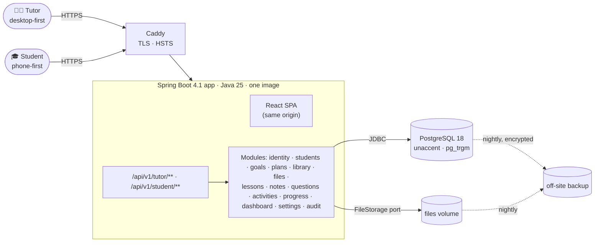
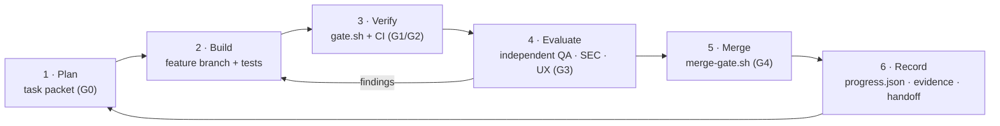

<div align="center">

# Eng-LMS

### A private 1:1 teaching workspace for one English tutor and their students

Students · lessons · learning plans · homework · tests · materials · feedback · progress.<br>
One calm workspace, **without a forced curriculum**.

<br>

[](https://github.com/duochou042004/eng-lms/actions/workflows/docs-check.yml)
[](https://github.com/duochou042004/eng-lms/actions/workflows/secrets-scan.yml)
[](docs/01-product/roadmap.md)
[](docs/10-governance/decision-log.md)
[](#licence)

[](docs/03-architecture/adr/ADR-0002-java25-spring-boot4-maven.md)
[](docs/03-architecture/tech-stack.md)
[](docs/03-architecture/adr/ADR-0001-modular-monolith-spring-modulith.md)
[](docs/03-architecture/adr/ADR-0003-postgresql-jpa-flyway.md)
[](docs/03-architecture/adr/ADR-0004-react-vite-spa-same-origin.md)
[](docs/05-frontend/frontend-architecture.md)
[](docs/03-architecture/tech-stack.md)
[](docs/03-architecture/adr/ADR-0012-podman-quadlet-caddy-deployment.md)

[](docs/05-frontend/accessibility.md)
[](docs/03-architecture/adr/README.md)
[](https://www.conventionalcommits.org/en/v1.0.0/)
[](docs/09-harness/hoh-operating-model.md)

**[Documentation](docs/README.md)** · **[Roadmap](docs/01-product/roadmap.md)** · **[Architecture](docs/03-architecture/architecture-overview.md)** ·
**[Requirements](docs/02-requirements/functional-requirements.md)** · **[Decisions](docs/10-governance/decision-log.md)** · **[For agents](CLAUDE.md)**

</div>

---

> [!IMPORTANT]
> **Status:** the planning baseline (M0) was approved by the Product Owner on 2026-09-25. The project is now in **M1: walking skeleton and delivery
> pipeline**. There is no product code yet, by design: every increment goes through gated plan → build → independent review loops.
> The live state is in [`progress.json`](progress.json); the narrative handoff is in [`docs/handoff/HANDOFF.md`](docs/handoff/HANDOFF.md).

## Contents

- [Why this exists](#why-this-exists)
- [What it is and what it is not](#what-it-is-and-what-it-is-not)
- [Core ideas](#core-ideas)
- [Architecture at a glance](#architecture-at-a-glance)
- [Roadmap](#roadmap)
- [How we build it](#how-we-build-it)
- [Getting started](#getting-started)
- [Repository layout](#repository-layout)
- [Documentation map](#documentation-map)
- [Licence](#licence)

## Why this exists

Private tutors usually run 1:1 teaching across **Zalo + Google Drive + Word/PDF + Zoom/Meet + Sheets**. Eng-LMS brings the teaching side
into one private workspace, so a tutor can open it and answer straight away:

| Who am I teaching today? | What does this student need? | What did we do last time? | What should I teach next? |
|:---:|:---:|:---:|:---:|
| **What homework is pending?** | **What result did they get?** | **Where is the material?** | **How are they progressing?** |

> *"Better to have a small system that the tutor actually wants to use every day than a giant system that creates more work than it removes."*
> ([the product specification](docs/00-sources/personal_english_tutor_teaching_workspace_spec.md), §58)

## What it is and what it is not

| ✅ It is | ❌ It is not |
|---|---|
| A personal teaching workspace for **one tutor** | A school or language-centre LMS, or a multi-tenant SaaS |
| Student-centred: every learner gets their own workspace and plan | A course catalogue that everyone must follow |
| Generic engines (lessons, assignments, assessments, goals) filled with **the tutor's own content** | A platform of pre-built TOEIC or IELTS content |
| Private: students see only their own data | A marketplace, a booking or payment platform, a social network |
| Links to the tools tutors already use (meeting URLs, contacts) | A chat, video-conferencing, Drive-replacement or AI-tutor product |

Full scope, including the explicit non-goals: [`docs/01-product/scope.md`](docs/01-product/scope.md).

## Core ideas

<table>
<tr>
<td width="25%" valign="top"><b>Student workspace first</b><br><sub>Profile, goals, learning plan, lessons, work, materials, progress and private notes, per student. Nothing is mandatory to set up.</sub></td>
<td width="25%" valign="top"><b>Generic engine, your content</b><br><sub>One activity engine powers homework, quizzes and mock tests. Question types are plug-ins. Metrics and goals are tutor-defined.</sub></td>
<td width="25%" valign="top"><b>Private by design</b><br><sub>Student A never sees Student B. Tutor notes never reach students. Isolation is structural and tested on every build.</sub></td>
<td width="25%" valign="top"><b>Few clicks</b><br><sub>Critical flows have step budgets, e.g. the after-lesson wrap-up takes ≤ 7 steps on phone, tablet and laptop.</sub></td>
</tr>
</table>

## Architecture at a glance

A **modular monolith** (Spring Modulith) with one deployable image, one PostgreSQL database and a reverse proxy. No microservices,
brokers or search clusters (see [ADR-0001](docs/03-architecture/adr/ADR-0001-modular-monolith-spring-modulith.md)).



<details>
<summary><b>Key architecture decisions</b> (16 ADRs)</summary>

| ADR | Decision |
|---|---|
| [0001](docs/03-architecture/adr/ADR-0001-modular-monolith-spring-modulith.md) | Modular monolith with Spring Modulith, with boundaries verified in CI |
| [0005](docs/03-architecture/adr/ADR-0005-session-cookie-auth.md) | Server-side session cookies (Spring Session JDBC); no JWT |
| [0007](docs/03-architecture/adr/ADR-0007-unified-activity-engine.md) | One activity engine for assignments and assessments |
| [0008](docs/03-architecture/adr/ADR-0008-snapshot-on-assign.md) | Immutable snapshot when work is assigned, so grades stay reproducible |
| [0009](docs/03-architecture/adr/ADR-0009-question-types-registry-jsonb.md) | Question types as registered plug-ins with JSON content |
| [0013](docs/03-architecture/adr/ADR-0013-design-system-react-aria-css-modules.md) | In-house design system on React Aria Components + CSS Modules + tokens |
| [0016](docs/03-architecture/adr/ADR-0016-student-namespace-isolation.md) | Student API namespace without any `studentId` parameter |

All ADRs: [`docs/03-architecture/adr/`](docs/03-architecture/adr/README.md).
</details>

## Roadmap

| | Milestone | Outcome |
|:---:|---|---|
| ✅ | **M0** Planning baseline | Documentation system, ADRs, harness, `progress.json` |
| 🔄 | **M1** Walking skeleton | Repo governance, backend and web skeletons, Podman stack, CI, E2E harness |
| ⏳ | **M2** Identity and students | Login, add-student flow with a credentials card, student workspace shell |
| ⏳ | **M3** Schedule and lessons | Lessons, Today view, private notes |
| ⏳ | **M4** Library and files | Folders, materials, lesson templates, sharing |
| ⏳ | **M5** Assignments and **wrap-up** | One-screen after-lesson flow, homework, grading and feedback |
| ⏳ | **M6** Question bank and assessments | 8 question types, auto-grading, timed tests, rubrics |
| ⏳ | **M7** Goals, plans and progress | Metrics, learning plans, progress views, attention rules |
| ⏳ | **M8** Release 1.0 | Security, accessibility and performance audits, backup drill, deployment |

Details and exit criteria: [`docs/01-product/roadmap.md`](docs/01-product/roadmap.md) · task backlog: [`docs/tasks/backlog.md`](docs/tasks/backlog.md).

## How we build it

Development follows a **Harness-of-Harnesses** model: small task packets, each implemented on its own branch and **independently evaluated**
before the Lead Coordinator merges it. State, evidence and decisions live in the repository, never only in a chat.



- **Branches:** `master` holds releases; `develop` is integration; `feature/`, `fix/`, `docs/` and `chore/<task-id>-<slug>` branch off `develop` ([git governance](docs/09-harness/git-governance.md)).
- **Merging:** only through [`scripts/merge-gate.sh`](scripts/merge-gate.sh). It requires green checks, the reviewer verdicts, `LC-APPROVED`, an up-to-date branch and an updated `progress.json`.
- **Quality gates G0–G6:** [`docs/06-quality/quality-gates.md`](docs/06-quality/quality-gates.md) · agent roles and permissions: [`docs/09-harness/agent-roles.md`](docs/09-harness/agent-roles.md).

## Getting started

> [!NOTE]
> Only the documentation and governance tooling exist today. The application commands arrive with M1 (see
> [`docs/07-operations/development-setup.md`](docs/07-operations/development-setup.md)).

```bash
git clone https://github.com/duochou042004/eng-lms.git && cd eng-lms
./scripts/install-hooks.sh        # blocks direct/force pushes to master and develop
./scripts/check-docs.sh           # docs gate: progress.json schema, links, ID references, source integrity
./scripts/tests/run-all.sh        # tests for the merge gate, path ownership and pre-push hook
```

<details>
<summary><b>Toolchain</b> (verified versions)</summary>

| Tool | Version | Notes |
|---|---|---|
| JDK | Temurin 25.0.4 | via SDKMAN (`.sdkmanrc`) |
| Spring Boot CLI | 4.1.0 | project generated with `spring init` |
| Node.js | 24.21.0 | via nvm (`.nvmrc`); pnpm through corepack |
| Podman | 5.8.6 (rootless) | podman-compose for the dev database; Quadlet in production |
| GitHub CLI | 2.101 | PRs, checks, merge gate |

</details>

## Repository layout

```text
docs/           product → requirements → architecture → backend → frontend → quality → ops → extensibility → harness → governance
evidence/       reproducible proof per task (commands, logs, screenshots, reviews)
scripts/        check-docs, merge-gate, path ownership, git hooks, tests
.claude/        agent definitions, project skills and permission settings
.github/        CI workflows, PR template, Dependabot
progress.json   machine-readable project state (schema: docs/09-harness/schemas/progress.schema.json)
backend/ web/ e2e/ qa/ deploy/ api/   ← created during M1
```

## Documentation map

| If you want… | Read |
|---|---|
| The product in 10 minutes | [Product brief](docs/01-product/product-brief.md) → [Scope](docs/01-product/scope.md) |
| What exactly gets built | [Functional requirements](docs/02-requirements/functional-requirements.md) · [Traceability matrix](docs/02-requirements/traceability-matrix.md) |
| How it is built | [Architecture overview](docs/03-architecture/architecture-overview.md) · [Domain model](docs/03-architecture/domain-model.md) · [Data model](docs/03-architecture/data-model.md) |
| How it looks and behaves | [Design system](docs/05-frontend/design-system.md) · [UX flows](docs/05-frontend/ux-flows.md) · [Responsive standards](docs/05-frontend/responsive-standards.md) |
| How it stays safe | [Security spec](docs/04-backend/security.md) · [Risk register](docs/10-governance/risk-register.md) |
| What is still open | [Open questions](docs/10-governance/open-questions.md) · [Decision log](docs/10-governance/decision-log.md) |
| Everything | [Documentation index](docs/README.md) |

## Licence

No open-source licence has been chosen. This is a private repository, and all rights are reserved by its owner.

<div align="center">
<sub>Built with gated, evidence-driven increments · the source of truth is <a href="docs/00-sources/personal_english_tutor_teaching_workspace_spec.md">the product specification</a></sub>
</div>
